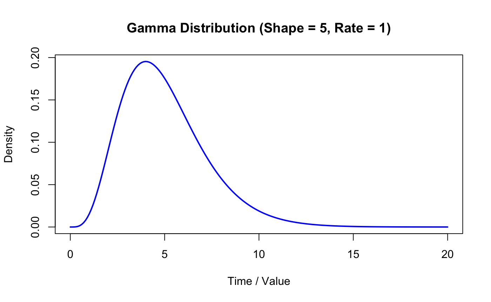
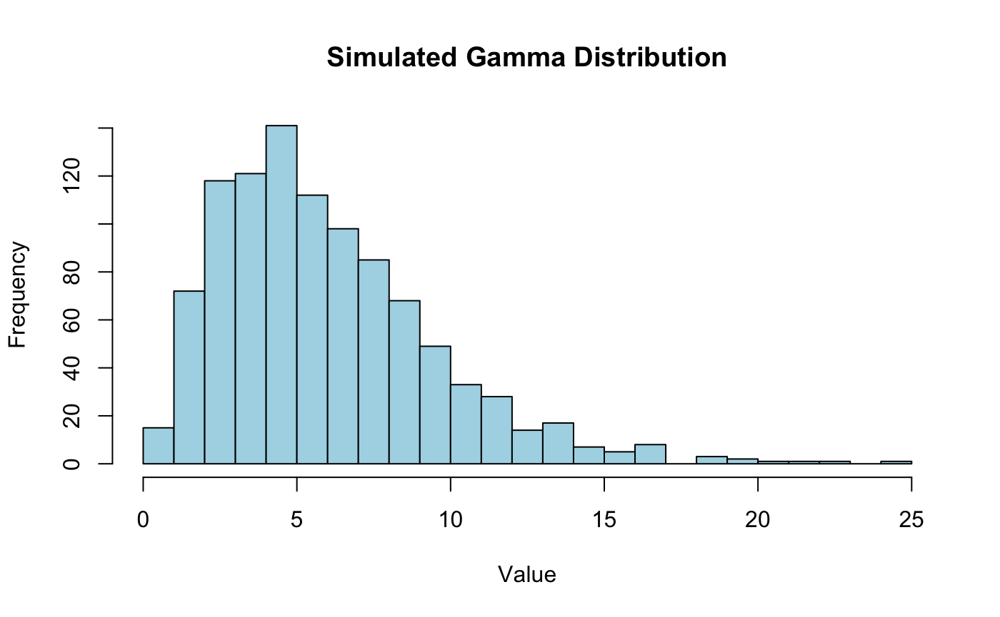

# Gamma Distribution


#### Key Concepts
R provides four main functions to work with the gamma distribution

1. `dgamma(x, shape, rate)`: Computes the probability density function (PDF).
2. `pgamma(q, shape, rate)`: Computes the cumulative distribution function (CDF).
3. `qgamma(p, shape, rate)`: Computes quantiles (inverse of CDF).
4. `rgamma(n, shape, rate)`: Generates n random numbers from the distribution.

(Note: Base R functions use the rate parameter by default. If you prefer using the scale parameter (\(\theta \)), you must explicitly set scale = theta.)

**Example 1:** Plotting the probability Density Function
Plot the shape of a gamma distribution using `dgamma()`, in this example, lets plot the gamma with a shape of 5 and rate of 1.

```r
# Create a sequence of x values from 0 to 20
x <- seq(0, 20, by = 0.1)

# Calculate the gamma density (shape = 5, rate = 1)
y <- dgamma(x, shape = 5, rate = 1)

# Plot the probability density function
plot(x, type = "l", y, col = "blue", lwd = 2, 
     main = "Gamma Distribution (Shape = 5, Rate = 1)", 
     xlab = "Time / Value", ylab = "Density")
```



**Example 2:** fCalculating Cumilative Probabilities
Suppose you are waiting for events and want to find the probability that the tortal waiting time is less than or equal to a certian value `q`. 

```r
# Find the probability that X <= 8 with shape = 5 and rate = 1
prob <- pgamma(8, shape = 5, rate = 1)
print(prob)
```
Output:  
`[1] 0.9003676`

**Example 3:** Generating Random Samples
If you want to simulate 1,000 random observations from a gamma distribution, (e.g., modeling repair times, or customer wait times):

```r
# Set a seed for reproducibility
set.seed(42)

# Generate 1000 random values with shape = 3 and scale = 2 (rate = 0.5)
simulated_data <- rgamma(1000, shape = 3, scale = 2)

# View the first few values
head(simulated_data)

# Plot a histogram of the simulated data
hist(simulated_data, breaks = 30, col = "lightblue", 
     main = "Simulated Gamma Distribution", xlab = "Value")
```
Output:  
`[1] 10.275115  3.373710  5.152571  2.117020  4.670036  3.136948`




